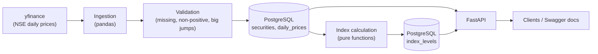

# Mini Index Data Platform


A small version of what index providers such as FTSE Russell do: ingest daily stock prices, validate them, calculate a stock market index, and serve it through an API.

It tracks 20 large NSE-listed Indian stocks in an equal-weighted "Top 20 Index" with a base value of 1000.

## Architecture



## Tech stack

Python 3.13, FastAPI, Pydantic, SQLAlchemy 2.0, Alembic, PostgreSQL 16, pandas, yfinance, pytest, ruff, mypy, Docker Compose, GitHub Actions.

## Quick start (Docker)

```bash
git clone https://github.com/sujanakg/mini-index-platform.git
cd mini-index-platform
cp .env.example .env
docker compose up --build -d
```

The API container applies the database migrations on startup. Then load the data:

```bash
docker compose exec api python -m scripts.seed_securities   # 20 NSE stocks
docker compose exec api python -m scripts.run_ingestion     # fetch, validate, load prices
docker compose exec api python -m scripts.run_index         # calculate and store index levels
```

Open http://localhost:8000/docs for the interactive API documentation.

## API endpoints

| Endpoint | Description |
|---|---|
| `GET /health` | Checks that the API is running and can reach the database |
| `GET /constituents` | The 20 stocks in the index |
| `GET /prices/{symbol}?from=&to=` | Daily prices for one stock, optional date range |
| `GET /index/latest` | The most recent index level |
| `GET /index/history?from=&to=` | Index levels over time, optional date range |

Errors are explicit: `404` for an unknown symbol or no data, `400` when `from` is after `to`, `503` when the database is unreachable.

## Index methodology

The index is **equal-weighted**: every stock counts the same.

```text
stock return(t)  = close(t) / close(t-1) - 1
index return(t)  = average of the stock returns on that day
index level(t)   = index level(t-1) * (1 + index return(t))
```

- The first date in the price table is the base date, with a level of 1000.
- If a stock has no valid price on a day, it is left out of that day's average.

## Data quality checks

Every batch of prices is validated before it is stored, and every problem is logged.

| Check | Action |
|---|---|
| Missing close price | Row rejected and logged |
| Zero or negative price | Row rejected and logged |
| Daily move above 20% | Row kept, flagged and logged for review |

Big moves are flagged, not deleted, because a real corporate action such as a stock split can look like a jump.

## Design decisions

- **Pure calculation functions.** The index logic takes a table in and returns a table out, with no database or network access, so it is easy to unit test.
- **Idempotent loading.** Prices and index levels are written with upserts, and `daily_prices` has a unique constraint on stock and date, so re-running the pipeline never creates duplicates.
- **`Numeric` for prices in the database**, not floating point, to avoid rounding errors with money values.
- **Migrations with Alembic**, applied automatically when the API container starts.
- **API tests use an in-memory SQLite database**, swapped in through FastAPI's dependency override. Tests are fast and need no running Postgres.

## Limitations

- Prices are stored as traded (unadjusted), so a stock split shows up as a flagged jump.
- Only an equal-weighted index is implemented. There is no market-cap weighting or rebalancing.
- Ingestion is run manually and there is no scheduler.
- Yahoo Finance is an unofficial free source, and a production system would use a licensed data feed.
- The API tests run on SQLite, so Postgres-specific behaviour is covered only by manual runs.

## Local development

```bash
python -m venv .venv
source .venv/bin/activate           # Windows Git Bash: source .venv/Scripts/activate
pip install -r requirements.txt
cp .env.example .env
docker compose up -d db
alembic upgrade head
python -m scripts.seed_securities
python -m scripts.run_ingestion
python -m scripts.run_index
uvicorn app.main:app --reload
```

Run the checks:

```bash
pytest -v
ruff check . && ruff format --check .
mypy app scripts tests
```

GitHub Actions runs ruff, mypy and pytest, and builds the Docker image, on every push to `main`.

## Project structure

```text
app/         API, models, ingestion, validation, loader, index calculation
alembic/     database migrations
scripts/     seed_securities, run_ingestion, run_index
tests/       index calculation, validation and API tests
.github/     CI workflow
```